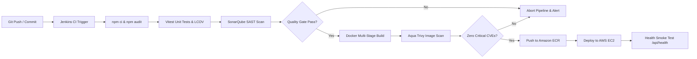

# DevSecOps CI/CD Pipeline Documentation

## 1. Pipeline Overview

SecureID features an end-to-end automated Continuous Integration and Continuous Delivery (CI/CD) pipeline built with **Jenkins Declarative Pipeline**, incorporating security verification gates at every step ("Shift-Left Security").

---

## 2. Detailed Pipeline Stages & Security Controls

### Stage 1: Checkout & Verification
- **Tool:** Git SCM
- **Security Check:** Verifies Git repository integrity and tracks immutable commit SHAs (`GIT_COMMIT`).

### Stage 2: Clean Dependency Installation & SCA
- **Tool:** `npm ci`, `npm audit`
- **Command:** `npm ci --no-audit --no-fund && npm audit --audit-level=high`
- **Security Gate:** Enforces exact versions from `package-lock.json` and flags high/critical dependency CVEs.

### Stage 3: Automated Unit & Integration Testing
- **Tool:** Vitest + Supertest
- **Command:** `npm test -- --coverage`
- **Security Gate:** Asserts password hashing logic, cookie flags (`HttpOnly`), input sanitization, and 403 status on unauthorized RBAC attempts. Generates LCOV code coverage.

### Stage 4: SonarQube Static Application Security Testing (SAST)
- **Tool:** SonarScanner + SonarQube Server
- **Command:** `sonar-scanner -Dsonar.projectKey=secureid-identity-system -Dsonar.sources=backend/src,frontend/src ...`
- **Quality Gate:** Requires Grade A maintainability, 0 blocker bugs, 0 security vulnerabilities, and 0 unreviewed security hotspots.

### Stage 5: Multi-Stage Containerization
- **Tool:** Docker Engine
- **Command:** `docker build --no-cache -t secureid:${IMAGE_TAG} .`
- **Security Gate:**
  - Build tools stripped from runtime layer
  - Minimal `node:20-alpine` base
  - Non-root user `USER node`

### Stage 6: Aqua Trivy Container Vulnerability Scan
- **Tool:** Aqua Security Trivy CLI
- **Command:** `trivy image --severity CRITICAL --exit-code 1 secureid:${IMAGE_TAG}`
- **Security Gate:** Automated blocking exit code (`--exit-code 1`) if any unmitigated Critical CVE is found in OS packages or npm dependencies. Generates `reports/trivy-image-report.json`.

### Stage 7: Amazon ECR Image Registry Push
- **Tool:** AWS CLI + Docker
- **Security Control:** AWS IAM least-privilege token authentication. The ECR repository enforces `image_tag_mutability = "IMMUTABLE"` to prevent image tampering.

### Stage 8: AWS EC2 Continuous Deployment
- **Tool:** OpenSSH + Docker Compose / Docker Run
- **Security Control:** Deploys container to an AWS EC2 Ubuntu instance provisioned via Terraform. Environment secrets are injected via `/etc/secureid/.env` rather than baked into the image.

### Stage 9: Automated Post-Deployment Health Check
- **Tool:** `curl`
- **Command:** `curl -fsS http://${EC2_HOST}/api/health`
- **Security Verification:** Confirms service status is `"UP"` and database connectivity is operational.
